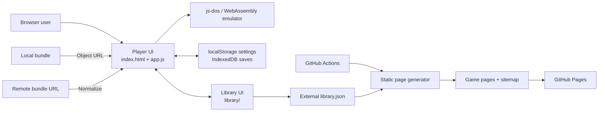
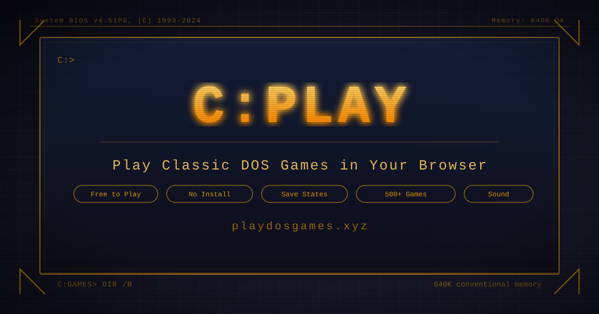

# C:\PLAY

A client-side DOS game player that runs `.jsdos` and `.zip` bundles in the browser, built to make js-dos approachable through a focused retro interface.

## Overview

C:\PLAY removes the need to install and configure a local DOS emulator for compatible game bundles. I built the player UI, bundle-loading paths, browser-based save management, searchable game library, and static deployment pipeline around [js-dos](https://js-dos.com/).

The application has no custom backend. Emulation and local-file handling stay in the browser, while the game catalog and remote bundles are fetched directly from their configured sources.

## Features

- Loads local `.jsdos` and `.zip` files through file selection or drag and drop.
- Launches remote bundles from direct URLs, GitHub links, and normalized Google Drive, Dropbox, or OneDrive share links.
- Saves, restores, previews, and deletes game states in the browser.
- Browses an external catalog with search, genre/decade/license/status filters, sorting, pagination, and random play.
- Supports fullscreen play, sound control, CPU-cycle and memory settings, and three interface tints.
- Provides both visual and DOS-command-inspired library navigation.

## Technical Highlights

- **Client-only emulation:** the UI initializes js-dos with a generated DOSBox configuration. CPU cycles, memory, and sound settings are validated, persisted in `localStorage`, and applied on launch.
- **Local persistence:** save-state bytes and optional canvas thumbnails are stored in IndexedDB. State conversion handles `ArrayBuffer`, typed-array, and array-shaped responses from the emulator API.
- **Resource lifecycle management:** starting or stopping a game exits the active emulator with a timeout, revokes local object URLs, clears the player, and closes tracked audio contexts to avoid leaking browser resources across sessions.
- **URL adaptation:** GitHub blob URLs become raw-content URLs, repository URLs resolve through the GitHub API to branch archives, and supported cloud-share URLs are rewritten as download links. Remote loading still depends on the host's CORS, authentication, and archive behavior.
- **Catalog isolation:** the standalone library normalizes external JSON entries before rendering and communicates with the embedded player through `postMessage`; direct navigation falls back to query-string launch URLs.
- **Defensive UI behavior:** loading overlays have a timeout, image failures use generated placeholders, library-fetch failures render an offline state, and user-controlled text is assigned through safe DOM APIs or escaped before HTML insertion.
- **Static publishing automation:** GitHub Actions runs a dependency-free Node.js generator, producing one metadata-rich page per catalog entry and rebuilding the sitemap before deploying the repository to GitHub Pages.

## Architecture



The main page owns emulator state and persistence. The library can run as an iframe inside that page or as a standalone route; in both cases it passes a selected bundle back to the player. Catalog data and game bundles are external dependencies, so the core interface remains static but catalog-backed features require network access.

## Tech Stack

- HTML5 and CSS3
- Vanilla JavaScript using ES modules and browser storage APIs
- [js-dos](https://js-dos.com/) / DOSBox WebAssembly runtime
- Node.js for static game-page and sitemap generation
- GitHub Actions and GitHub Pages
- Google Analytics 4

## Getting Started

Requirements: a modern browser, Python 3 for the local static server, and network access to js-dos. Catalog browsing also requires access to the configured external `library.json`.

```bash
git clone https://github.com/yal-pj/CPlay.git
cd CPlay
python -m http.server 4173
```

Open `http://localhost:4173`. Loading the files through `file://` is not supported because the application uses an ES module.

No dependency installation or build step is required for local use. To exercise the deployment generator separately, run:

```bash
node scripts/build-game-pages.js
```

That command requires network access and writes generated `games/` pages plus `sitemap.xml`; it is normally run by the deployment workflow.

## Demo

Live site: [playdosgames.xyz](https://playdosgames.xyz/)

[](https://playdosgames.xyz/)

## Project Status

**Active.** The player, external-catalog browser, save-state flow, static metadata generator, and GitHub Pages deployment are implemented. The repository currently has no automated test suite.

## What I Learned

- Browser-only architecture simplifies deployment and keeps local bundle data off an application server, but shifts reliability constraints to CORS policies, third-party URLs, and browser storage.
- Emulator integrations need explicit cleanup. Stopping runtimes, revoking object URLs, and closing audio contexts matters when users launch several games in one session.
- A remote catalog benefits from a normalization boundary: converting inconsistent source fields once keeps filtering, rendering, and launch behavior predictable.
- Static generation can add crawlable, game-specific metadata to a client-rendered application without introducing a long-running backend.
